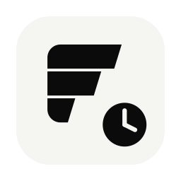
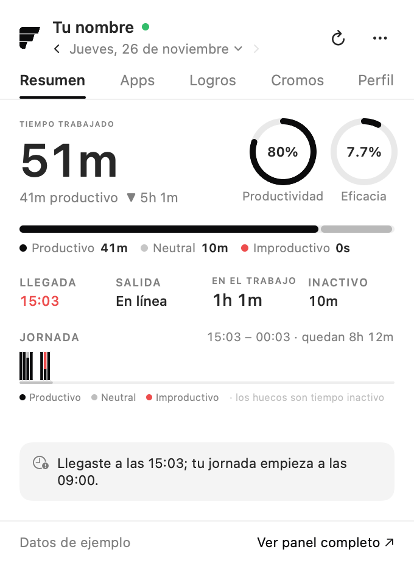
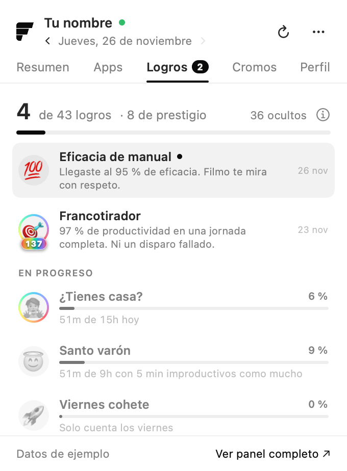
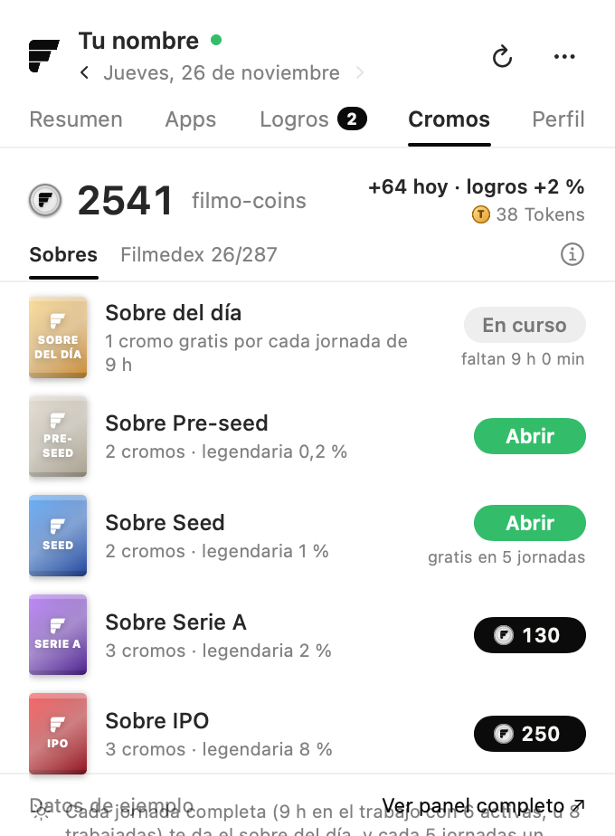
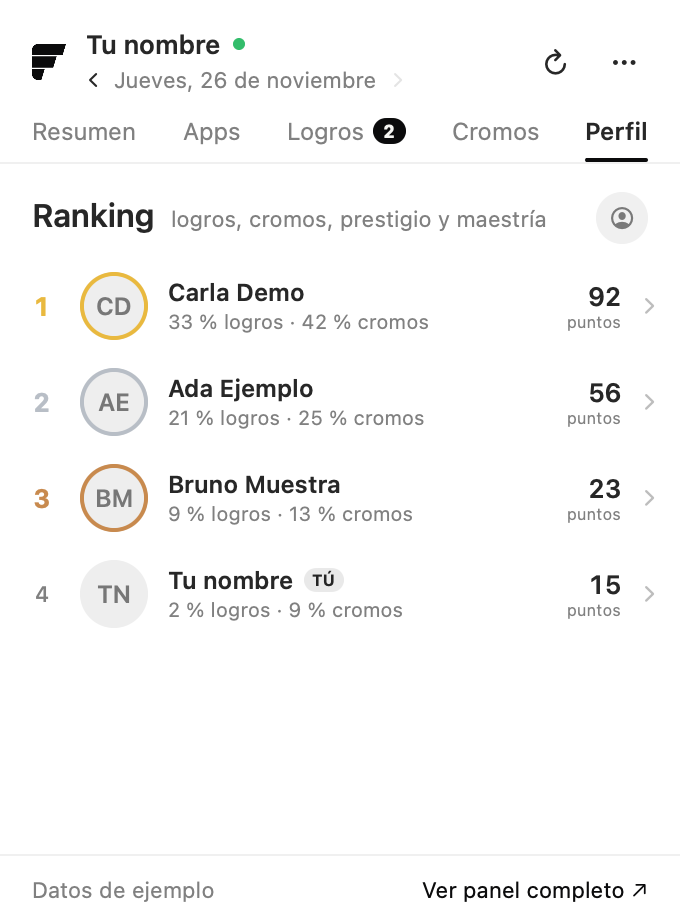

# Filmo Time

**Tu tiempo de trabajo de un vistazo, en la barra de menús de tu Mac.**

macOS 14 o posterior · Mac con Apple Silicon · Gratis

---

Filmo Time lee tus datos de [DeskTime](https://desktime.com) y los convierte en algo que apetece mirar: tu jornada, logros que desbloquear, cromos que coleccionar y un ranking con tus compañeros.

<table>
<tr>
<td align="center" width="25%"> <b>Resumen</b> Tu día y tu jornada</td>
<td align="center" width="25%"> <b>Logros</b> Con niveles y maestría</td>
<td align="center" width="25%"> <b>Cromos</b> Sobres y colección</td>
<td align="center" width="25%"> <b>Ranking</b> Tu perfil y el de todos</td>
</tr>
</table>

## Qué tiene

- **Resumen.** Tiempo trabajado, productividad y cómo va tu jornada, también en un widget del escritorio.
- **Logros.** Más de 40, algunos ocultos. Los que tienen niveles suben de Bronce a Maestro, y en Maestro siguen sumando puntos.
- **Cromos.** Tu trabajo se convierte en monedas para abrir sobres. Cada jornada completa te regala uno.
- **Perfil y ranking.** Pon tu foto, enseña tus mejores logros y cromos, y mira en qué puesto vas.

## Instalación

1. **Descarga** [Filmo-Time.dmg](https://github.com/filmo-io/filmo-time/releases/latest/download/Filmo-Time.dmg) y arrastra la app a **Aplicaciones**.
2. **Ábrela.** La primera vez macOS avisa de que no viene de la App Store: ve a **Ajustes del Sistema → Privacidad y seguridad** y pulsa **Abrir igualmente**.
3. **Pega tu API key de DeskTime.** Genérala en [desktime.com/app/api](https://desktime.com/app/api) y pégala en la ventana de la app.
4. **Listo.** Aparece una **F** en la barra de menús. Recomendado: activa **Abrir al iniciar sesión** en su menú.

Con una cuenta de DeskTime de Filmo entras solo en el ranking, sin apuntarte a nada.

## Preguntas frecuentes

<b>Cómo se actualiza</b>

Sola: cuando hay una versión nueva, la app te avisa y se instala con un clic. También puedes buscarla en el menú de la **F** → **Buscar actualizaciones…**

<b>Cómo añado el widget</b>

Clic derecho en el escritorio → **Editar widgets…** → busca **Filmo Time** y elige el tamaño.

<b>Qué datos salen de mi Mac</b>

- **A DeskTime,** con tu API key, para leer tus datos.
- **Al ranking:** tu nombre, foto, porcentajes, prestigio, qué logros y cromos tienes y una copia semanal de tu progreso en Filmo Time. Tu API key se envía una sola vez para comprobar que la cuenta es de Filmo, y no se guarda.
- Nada más: las imágenes de los cromos se descargan sin enviar nada tuyo.

La API key se guarda solo en tu Mac, en un archivo que únicamente puede leer tu usuario.

<b>Cómo cambio la API key o desinstalo la app</b>

Desde el menú de la **F**: **Configurar API key…** para cambiarla, o **Salir** y luego borra la app de Aplicaciones.

Hecho en Filmo · No afiliado a DeskTime

